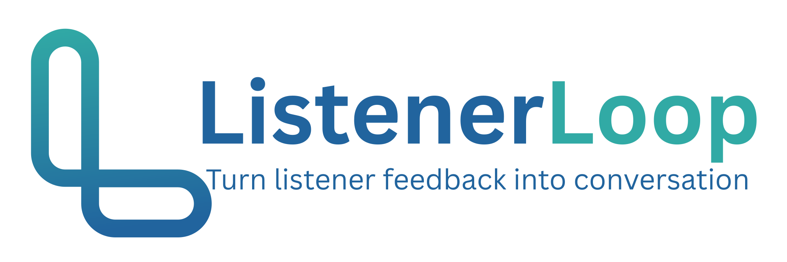

# ListenerLoop: Project Plan

<p align="center">
  
</p>

*Turn listener feedback into conversation.*

Last updated: 2026-10-27. Tick the checkboxes below as work lands. **Status:** Phase 1 is built, installed on an Ubuntu server behind a Cloudflare Tunnel, and tested by several people across browsers and devices. Items marked *(planned)* below are not built yet.

## Overview and goals

A self-hosted, open-source (AGPL) widget that lets listeners record a voice message from any podcast website, replacing SpeakPipe. One installation serves many shows, and every message lands in a private admin inbox as an MP3.

**Goals**

- Embed on any site with one script tag.
- Record in the browser using web standards only, on desktop and mobile (including iOS Safari).
- Normalize every recording to MP3.
- Store audio in S3-compatible buckets, with local disk as a fork-friendly option.
- Protect against spam with Cloudflare Turnstile.
- Alert the admin by email on each new message.

**Out of scope for v1**

- Sharing logins or data with the admin's other podcast tools. This is its own repository and its own installation.

## Decisions locked in

| Area | Decision |
| --- | --- |
| Backend | Node.js + TypeScript with Fastify. Workload is I/O-bound, so language speed is a wash; Node gives a mature S3 SDK and one language across server, embed and admin UI. |
| Database | SQLite (better-sqlite3) for v1, with append-only migrations. |
| Audio format | Every upload normalized to MP3 with ffmpeg. The original is kept optionally (config flag). |
| Storage | Adapter interface with two drivers: `s3` (any S3-compatible service, including Cloudflare R2) preferred, and `local` for forks. |
| Processing | ffmpeg run inline after upload through a simple in-process queue. No Redis. |
| Admin auth | Multiple users (owner, editor, viewer) with per-show access, argon2 password hashes, session cookie, optional TOTP. The admin UI is server-rendered pages with htmx for small live updates, with no SPA framework. |
| Email alerts | SMTP or Resend, chosen by config. |
| Spam protection | Cloudflare Turnstile is required for public submissions. One app-wide Turnstile key pair, created once for the app's own domain, covers every show; embedding sites need no Turnstile key of their own. There is no per-show override. |
| Transcription | Deferred to a later phase behind an optional adapter (whisper.cpp or an API). Off by default. |
| Deploy | Docker Compose on Ubuntu Server (app + Caddy for automatic HTTPS). A systemd install is documented for non-Docker users. |
| License | AGPL-3.0, matching PodSovereign. |
| Name | ListenerLoop. Tagline: "Turn listener feedback into conversation." Repository: `rgblack316/ListenerLoop`. Domain: `listenerloop.app`. |

## Architecture

```
Podcast website (embed.js adds a button)
        |  opens
        v
Widget iframe (recorder + Turnstile)
        |  POST recording
        v
App (Fastify): validates, converts to MP3 <---- Admin dashboard (inbox and playback)
   |            |             |
   v            v             v
Storage      Database      Email alert
(S3 or       (SQLite)      (SMTP or Resend)
local disk)
```

A listener's browser loads the widget from the app and posts one recording. The app validates it, converts it to MP3, stores the audio, saves the message record and sends an email alert. The admin dashboard reads from the same app, and audio is only reachable through authenticated requests.

## Embed contract

Site owners paste one line; everything else lives on the tool's own domain.

```html
<script src="https://voicemail.example.com/embed.js" data-site-key="pk_abc123" async></script>
```

1. `embed.js` (small, dependency-free) injects a button (or mounts into an element with `data-target`) styled by the show's config.
2. Clicking opens a modal containing an iframe pointing at `/widget?key=pk_abc123`, with `allow="microphone"`.
3. The iframe holds the recorder UI and the Turnstile challenge, so host-site CSS and JavaScript cannot interfere with it. Because the challenge runs on the app's own domain, embedding sites need no Turnstile key of their own.
4. The iframe posts events to the parent with `postMessage` (`vm:ready`, `vm:submitted`, `vm:close`). The parent only accepts them from the widget origin, and fires a `listenerloop:submitted` event on the button so the host page can react (for example, to show its own thank-you).

**Per-show configuration** (managed in admin, fetched by site key): button label and accent color, prompt text, maximum duration, whether the email field is shown (always optional for the listener; the name field is always shown and required), consent text, thank-you message, and the allowed origins list.

**Fallback link:** each show also gets a hosted page at `/s/<show-slug>`, the same recorder on its own page, for newsletters, social bios and browsers where iframe microphone access is blocked. The Shows page in admin lists each show's hosted link.

## Recording and processing pipeline

**In the browser**

1. Request the mic with `getUserMedia({ audio: true })` on a user click (required on iOS).
2. Record with `MediaRecorder`, choosing the first supported type from `audio/webm;codecs=opus`, `audio/mp4`, then the browser default.
3. Show a live level meter and timer; auto-stop at the configured maximum (default 3 minutes).
4. Ask for the listener's name (required) and, optionally, an email address. Let them play back, re-record, or submit once a name is entered.
5. Submit as `multipart/form-data` (audio blob, required name, optional email, consent flag, Turnstile token) in a single POST.
6. Listeners can also upload an audio file ("Or upload an audio file"), which is the fallback when the mic is unavailable or blocked (in-app browsers, permission denied) or when recording is not supported at all. The widget checks the file's size and length before sending, and plays it back like a recording.

**On the server**

1. Validate site key, origin, a non-empty sender name (up to 100 characters), a valid optional email, the consent flag, the size cap (default 15 MB), the per-IP rate limit and the Turnstile token (including its hostname).
2. Write the upload to a temp file and create a `messages` row with status `processing`.
3. Probe with `ffprobe` right after the Turnstile check, before the message is accepted: reject files with no audio stream or a container outside the allowlist (this also blocks playlist files that could make ffmpeg read local files or URLs) with `415`, and files with a known length over the show's limit with `400`, so the listener sees the problem straight away. Browser recordings have no length in their header, so those are measured after conversion.
4. Run `ffmpeg` (file protocol only, with a timeout) to produce MP3: mono, 44.1 kHz, 64 kbps by default, metadata stripped, capped at the show's maximum length. The real duration is measured from the MP3, because browser WebM recordings carry no duration in their header. Loudness normalization (EBU R128, -19 LUFS, the podcast standard for mono) is a per-show option, off by default, and applies to new messages. A 120-bar waveform is computed from the MP3 and stored with the message.
5. Hand the MP3 (and the original, if retention is on) to the storage adapter; set status `ready`; delete temp files.
6. Send the email notification. On failure, set status `failed`, record the reason and keep the original. The original is kept so the message can be retried from admin; uploads interrupted by a restart are re-queued at the next startup if the file survived, otherwise marked failed.

**Format notes:** Chrome and Firefox produce WebM/Opus, Safari and iOS produce MP4/AAC. The server never trusts the reported MIME type; `ffprobe` decides.

## Data model

Five tables for v1, plus `schema_migrations`. IDs are ULIDs; timestamps are UTC.

| Table | Key fields |
| --- | --- |
| `shows` | id, name, slug, site_key (public), allowed_origins (list), notify_email, max_seconds, ask_email, consent_text, button_label, accent_color, prompt_text, thanks_text, retain_original, transcribe, normalize_loudness, noise_reduction, created_at |
| `messages` | id, show_id, status (`processing`, `ready`, `failed`), starred, archived, sender_name (required), sender_email (optional), consent_given, duration_seconds, mp3_key, original_key, size_bytes, original_mime, ip_hash, user_agent, transcript (nullable, unused so far), notes, error, email_error, read_at, created_at, deleted_at |
| `admin` | id, email, password_hash (argon2id), created_at (single row in v1; becomes `users` with roles later) |
| `sessions` | token_hash (sha256 of the cookie token), admin_id, created_at, expires_at |
| `settings` | key, value (reserved for settings edited in admin; unused so far, settings come from environment variables) |

**Notes**

- IP addresses are stored only as a salted hash, used for rate-limit review, never in plain text.
- Deleting a message in the admin removes its MP3, any original and the database row (including the sender's name and email) straight away. If storage is unreachable, the message is hidden and an hourly sweep (also run at startup) retries until the files are gone. There is no undo. Automatic deletion by age (`RETENTION_DAYS`) uses the same removal and keeps starred messages.
- Storage keys follow `shows/<show_id>/<yyyy>/<message_id>.mp3` (originals use `.orig`) so buckets stay browsable.

## Routes

The admin is server-rendered, so there is no JSON admin API. Pages and form posts are listed below.

**Public**

| Route | Auth | Purpose |
| --- | --- | --- |
| `GET /embed.js` | none | Loader script (cacheable). |
| `GET /widget?key=` | site key | Recorder iframe page, served with `frame-ancestors` limited to the show's allowed origins. |
| `GET /api/public/config?key=` | site key + origin check | Show display settings and Turnstile site key. |
| `POST /api/public/messages` | site key, same-origin, Turnstile | Submit a recording; returns `202` with the message id. |
| `GET /healthz` | none | Health check for Docker and uptime monitors. |
| `GET /s/:slug` | none | Hosted recording page for a show (the widget on its own page; cannot be framed). |

**Admin (session cookie, CSRF token on every post)**

| Route | Purpose |
| --- | --- |
| `GET /login`, `POST /login`, `POST /logout` | Sign in and out (login attempts are throttled). |
| `GET /` | Your shows with unread counts. One show goes straight to its inbox; no shows goes to the add-show page. |
| `GET /inbox` | All shows combined, with status filters and pagination. |
| `GET /shows` | Manage shows: embed code, allowed sites, rotate key. |
| `GET /shows/new`, `POST /shows` | Create a show. |
| `GET /shows/:slug` | One show's inbox. |
| `GET /shows/:slug/settings`, `POST /shows/:slug/settings` | Edit a show. |
| `POST /shows/:slug/rotate-key` | Issue a new site key. |
| `GET /shows/:slug/messages/:id` | Message page (marks it read). |
| `POST /shows/:slug/messages/:id/star`, `/archive`, `/delete`, `/notes` | Message actions (htmx or plain forms). |
| `GET /shows/:slug/messages/:id/audio` | Local driver: streamed with HTTP Range. S3 driver: redirect to a signed URL that expires in 5 minutes. Add `?download=1` to download. |
| `POST /shows/:slug/messages/:id/retry` | Re-run a failed message from its saved original (after fixing the cause, such as raising the show's length limit). |
| `POST /shows/:slug/messages/:id/resend-alert` | Send the email alert again after a failure. |
| `GET /settings` | Settings page: email test, storage check, read-only configuration. |
| `GET /users`, `GET /users/:id` | Owner only: manage users, invitations and reset links. |
| `GET /shows/:slug/webhooks` | Owner only: webhooks for a show. |
| `GET /inbox/export.csv`, `/shows/:slug/export.json` | Everyone: export visible messages (CSV or JSON). |
| `GET /account` | Everyone: name, password, two-step sign-in. |
| `GET /invite/:token`, `GET /reset/:token` | Public: accept an invitation or choose a new password. |
| `POST /settings/test-email`, `/settings/test-storage`, `/settings/password` | Send a test email to the admin; write, read and delete a test file in storage; change the admin password (signs out other sessions, throttled). |

A message opened under another show's URL returns 404. Public routes send CORS headers only for the show's allowed origins.

## Storage adapters

The app talks to one small interface, so a driver can be swapped with a single environment variable.

```ts
interface StorageDriver {
  put(key: string, file: string | Buffer, contentType?: string): Promise<void>;
  getStream(key: string, range?: { start: number; end: number }): Promise<Readable>;
  size(key: string): Promise<number | null>;
  exists(key: string): Promise<boolean>;
  delete(key: string): Promise<void>;
  getSignedUrl?(key: string, ttlSeconds: number, opts?: { contentType?: string; downloadName?: string }): Promise<string>;
}
```

| Driver | Details |
| --- | --- |
| `s3` | AWS SDK v3 against any S3-compatible endpoint (R2, Backblaze B2, MinIO, AWS). Private bucket; admin playback uses short-lived signed URLs. |
| `local` | Files under a mounted data directory. Audio is streamed through the app with HTTP range support so seeking works. |

Buckets are always private. Audio is never publicly addressable; only authenticated admin requests can obtain a URL. Use a bucket and access key dedicated to ListenerLoop, separate from any public podcast CDN bucket.

## Admin dashboard

Server-rendered pages, with htmx for small live updates such as starring or archiving without a page reload. The layout is mobile-friendly so messages can be reviewed from a phone. See Routes above for URLs.

**Built (Phase 1)**

- **Your shows:** each show with its unread count, plus a link to all messages combined.
- **Inbox:** one inbox per show and a combined view; filter by new, starred, archived, failed; newest first; unread indicator; the sender's name appears on every row so you know who left a message before you play it.
- **Message view:** audio player with speed control, sender details, duration, date, private notes, star, archive, delete, download MP3.
- **Shows:** create and edit shows, copy the embed snippet, rotate the site key, edit allowed origins and widget text and color, optional per-show Turnstile key.
- **Settings:** a test-email button, a storage check (write, read, delete a test file), and a read-only view of the configuration. Configuration itself stays in `.env`.
- **Admin accounts:** the first owner is created from the command line (`create-admin`); there is no setup screen. Owners add others by invitation.

**Planned**

- Search, and bulk actions (zip download, archive, delete).
- Live widget preview when editing a show.

## Security and abuse protection

| Threat | Control |
| --- | --- |
| Bots and spam | Turnstile token verified server-side on every submission, using the app-wide secret key, and the returned hostname is checked against the app's domain; token is single use. |
| Flooding | Per-IP limit (default 5 submissions per hour), a per-show limit from everyone (default 60 per hour) and a daily cap per show (default 300). Over a limit, the listener sees a polite "try again later". |
| Oversized or fake audio | Request size cap, duration cap, `ffprobe` validation with a container allowlist, ffmpeg limited to the file protocol and run with a timeout, one conversion at a time. |
| Site key misuse | Site keys are public by design, so the origin allowlist, Turnstile and rate limits do the real work. Keys can be rotated. |
| Clickjacking and framing | `frame-ancestors` restricted to a show's allowed origins on `/widget`; admin pages send `X-Frame-Options: DENY`. |
| Admin takeover | Argon2id hashing, login throttling (8 failures per 15 minutes per IP), HttpOnly + Secure + SameSite=Strict session cookie (stored hashed), CSRF tokens, same-origin checks, optional TOTP later. |
| Audio leakage | Private bucket, short-lived signed URLs, no public audio routes, and a message is only served under its own show's URL. |
| XSS from listener input | All names, emails and notes escaped on output; strict Content-Security-Policy (no inline scripts or styles) on every page. |

**Privacy**

- A consent line is shown before recording, with configurable text per show.
- The email field is shown by default but is always optional, with a note that it is only used to reply. The name field is always shown and required, so the podcaster knows who left a message before listening. Only the email field can be hidden per show.
- Deleting is permanent, and retention is configurable (`RETENTION_DAYS`, starred messages are kept), and listeners can be given a contact address to request removal.
- Uploaded filenames and client metadata are never trusted or stored as paths.

## Notifications

A mail adapter with two providers, chosen by `MAIL_PROVIDER`:

- **`smtp`:** works with any provider through host, port, user and password.
- **`resend`:** a single API key, using Resend's HTTP API.

Each new message sends the show's `notify_email` (or the admin's email if none is set) a short note with the show name, duration, the sender's name (and email if shared), and a link to the admin page. Audio is not attached, which keeps the email small and the recording private. Sending is asynchronous, so an email failure never blocks or fails a submission; it is logged and shown on the message in admin (an "email failed" badge, the reason, and a button to send it again).

## Configuration reference

All settings come from environment variables (a `.env` file in Docker Compose).

| Variable | Purpose | Default |
| --- | --- | --- |
| `APP_URL` | Public base URL, used in embed code, emails and the Origin and Turnstile hostname checks | required |
| `SESSION_SECRET` | Signs sessions and encrypts stored secrets (at least 32 characters) | required |
| `TURNSTILE_SITE_KEY`, `TURNSTILE_SECRET_KEY` | App-wide Turnstile keys. The key's hostname list needs only the app's own domain | required |
| `APP_DOMAIN` | Domain only, used by Caddy in Docker Compose | none |
| `DATA_DIR` | Base folder for data | `./data` |
| `DATABASE_PATH` | SQLite file location | `<DATA_DIR>/app.db` |
| `STORAGE_DRIVER` | `s3` or `local` | `local` |
| `LOCAL_STORAGE_PATH` | Directory for the local driver | `<DATA_DIR>/audio` |
| `S3_ENDPOINT`, `S3_REGION`, `S3_BUCKET` | S3-compatible bucket settings | none |
| `S3_ACCESS_KEY_ID`, `S3_SECRET_ACCESS_KEY` | Bucket credentials | none |
| `S3_FORCE_PATH_STYLE` | Path-style addressing for services such as MinIO | `false` |
| `MAIL_PROVIDER` | `smtp`, `resend` or `none` | `smtp` |
| `SMTP_HOST`, `SMTP_PORT`, `SMTP_USER`, `SMTP_PASS`, `MAIL_FROM` | SMTP settings | none (port 587) |
| `RESEND_API_KEY` | Resend API key | none |
| `MAX_UPLOAD_MB` | Upload size cap | `15` |
| `MAX_SECONDS_DEFAULT` | Default recording length for new shows | `180` |
| `MP3_BITRATE_KBPS` | Output bitrate | `64` |
| `KEEP_ORIGINALS` | Keep the uploaded original alongside the MP3 (a show can also turn this on) | `false` |
| `RATE_LIMIT_PER_HOUR` | Submissions per IP per hour | `5` |
| `RATE_LIMIT_PER_SHOW_HOUR` | Submissions per show per hour, from everyone | `60` |
| `DAILY_CAP_PER_SHOW` | Submissions per show per 24 hours, from everyone | `300` |
| `TRUST_PROXY` | Trust forwarded client IP headers; set `false` only if exposed directly | `true` |
| `PORT`, `HOST`, `LOG_LEVEL` | Server listen settings and log level | `3000`, `0.0.0.0`, `info` |
| `FFMPEG_PATH`, `FFPROBE_PATH` | Locations of the ffmpeg tools | `ffmpeg`, `ffprobe` |
| `RETENTION_DAYS` | Delete messages older than N days, checked hourly and at startup (0 = keep forever). Starred messages are kept | `0` |
| `TRANSCRIBE_PROVIDER` | `none`, `whispercpp` or `api` (later phase, not read yet) | `none` |

## Deployment

**Docker Compose (primary)**

- Services: `app` (Node image with ffmpeg and ffprobe included) and `caddy` (automatic HTTPS and reverse proxy, enabled by the `caddy` compose profile). For a Cloudflare Tunnel, `docker-compose.tunnel.yml` publishes the app on `127.0.0.1:3000` instead. `COMPOSE_PROFILES` / `COMPOSE_FILE` in `.env` pick the mode.
- `scripts/install.sh` (Ubuntu and Debian): installs missing tools including Docker from Docker's official apt repository, asks for settings, writes `.env` (private, secrets kept on re-runs, `SESSION_SECRET` generated once), starts the stack, and creates the admin and first show. It can also be fed answers through environment variables with `--yes`.
- One volume for `/data` (SQLite and, with the local driver, audio); Caddy has its own volume for certificates.
- Image runs as a non-root user; `/healthz` backs the container health check.
- Upgrades: `scripts/update.sh` re-checks dependencies, backs up the SQLite database inside the data volume (newest 7 kept), fast-forwards the git checkout, rebuilds and restarts, and reports new settings in `.env.example`; migrations run automatically at startup. It refuses to run over local changes to tracked files and prints rollback steps if the new version is unhealthy.
- The install script, Docker build and Cloudflare Tunnel setup are confirmed working on a real Ubuntu server.

**systemd (alternative)**

- *(planned)* Documented steps for Ubuntu Server: install Node LTS and ffmpeg, build the app, run it under a service unit, and put Caddy or Nginx in front.

**Backups**

- SQLite: nightly consistent copy via `scripts/backup.sh` (cron), shipped off-box by the operator.
- Audio: with the `s3` driver, sync the bucket to a second bucket or provider (R2 has no versioning; S3 and B2 do); with `local`, include `/data/audio` in the backup.
- Restore is `scripts/restore.sh` (see the README).

## Phased milestones

Each phase is done only when its acceptance criteria pass.

### Phase 1: MVP

- [x] Project scaffold: Fastify, TypeScript, SQLite migrations, Docker Compose with Caddy.
- [x] Show and site-key management (seeded or CLI first).
- [x] Embed loader, modal and recorder iframe with Turnstile.
- [x] Upload endpoint with validation, ffprobe check and ffmpeg MP3 conversion.
- [x] Storage adapters: `local` and `s3`.
- [x] Admin login, per-show inboxes (`/shows/<slug>`), combined inbox and audio playback.
- [x] Email alert through SMTP or Resend.

**Acceptance (met: tested by several people on different browsers and devices with the live install; recordings arrive as MP3s in S3-compatible storage and email alerts reach the inbox):** a message recorded on Chrome desktop, Android Chrome and iOS Safari through an embed on a test page appears in the inbox as a playable MP3 and triggers an email, using both storage drivers.

### Phase 2: Hardening

- [x] Rate limits, origin allowlist, CSP and `frame-ancestors`, with a scripted abuse test run (`test/abuse.test.ts`): 15 kinds of bad request, the per-IP, per-show and daily limits, and a check that nothing is stored and no temporary file is left.
- [x] Per-show widget settings with live preview in admin (`/static/preview.html`, synced by postMessage as you type).
- [x] File-upload fallback and hosted `/s/:slug` page.
- [x] Retry for failed processing, with the failure reason shown in the inbox, and email-alert failures shown on the message with a resend button.
- [x] Automatic deletion by age (`RETENTION_DAYS`). Starred messages are kept.
- [x] Backup and restore: `scripts/backup.sh` and `scripts/restore.sh`, documented in the README, round trip tested.
- [x] In-app browser testing: Facebook confirmed working; Instagram treated as working (same WebView structure, not tested separately).

**Acceptance:** scripted abuse tests (oversized file, wrong type, missing token, bad origin, rapid repeat) are all rejected; a restore from backup on a clean server succeeds.

### Phase 3: Quality of life

- [x] Search: SQLite FTS5 index over name, email, notes and transcript (migration 3), search box in every inbox, prefix and accent-insensitive matching, transcript snippets with highlights. Transcripts become searchable as soon as `messages.transcript` is written.
- [x] Bulk zip download: tick messages in any inbox, get one .zip of MP3s, transcript .txt files and a `messages.csv` index (formula-safe). Streams one file at a time, up to 100 messages, limited to shows the signed-in user can open.
- [x] Waveform display in the player: peaks computed at processing time (older messages are filled in at startup), click or drag to seek.
- [x] Optional transcription: whisper.cpp built into the image, per-show toggle (migration 4), separate low-priority queue after the email alert, model downloaded on first use, retry/re-run from the message page, .txt download, searchable. A hosted-API adapter is still possible behind the same interface (`TRANSCRIPTION=...`).
- [x] Loudness normalization option (per show, migration 5).
- [x] Background noise reduction (per show, migration 6): Off, Light (high-pass 80 Hz plus `afftdn`) or Stronger (high-pass plus the RNNoise neural model through `arnndn`, vendored in `models/`). Runs before loudness normalization in the same ffmpeg pass, and applies to new messages only.

**Acceptance (met):** with transcription enabled, a new message gains a searchable transcript without delaying the email alert. Phase 3 is complete.

### Phase 4: Later

- [x] Show cover art from the podcast's RSS feed (optional feed address per show, migration 9): fetched with an SSRF-safe client (public addresses only, redirect, size and time limits), re-encoded to a 256 px JPEG with ffmpeg, stored in the storage driver at `covers/<show>.jpg`, served only to signed-in users, and shown beside the show name in the shows list, home list, inbox and settings. Refresh on save or on request.

- [x] Reply to listeners who chose to share an email address, from the message page in admin. Sent through the configured mail provider from `REPLY_FROM_ADDRESS` (for example replies@listenerloop.app) with the show's name as the display name and the show's email address as Reply-To, so the listener's answer goes straight to the host. The show's email address is now required in show settings. Replies are stored with the message (migration 8), shown as a thread, retryable if sending fails, limited to 10 per message and 30 per hour, and deleted with the message.
- [x] Multi-user admin (migration 10). Roles: owner (everything), editor (all message actions on assigned shows), viewer (read-only on assigned shows). Owners invite by emailed link (7 days, invitee sets the password; the link is shown for copying if email is off or fails), make password reset links, enable or disable, remove and re-scope users, and cannot remove the last active owner. Per-show access goes through `accessibleShows()`; message, audio, cover, zip and reply routes all use it. Optional TOTP per user with recovery codes, an owner reset, and a two-step login. Existing single admin becomes the first owner; sessions are cleared once on upgrade.
- [x] Webhooks (migration 11): up to 3 per show, managed by owners; events `message.ready`, `message.transcribed`, `reply.sent`; HMAC-SHA256 signed (`X-ListenerLoop-Signature`), https only, sent through the same public-address-only client as cover art (no redirects), retried 5 times with growing delays from a database-backed log (survives restarts), test button, 30 days of delivery history. CSV and JSON export of the inbox (or one show), honoring the filter, search and the user's show access; spreadsheet formulas are defused. A private RSS feed was considered and left out.
- [x] In-app backups (migration 12), owner-only on the Settings page above Configuration: back up now or on a daily or weekly schedule (UTC hour), keep the newest N, download or delete from the list. Uses SQLite's online backup for a consistent database copy and `tar` to add local audio in place; no `.env`. With the S3 driver the owner chooses where archives live: server only, bucket only (`backups/`, streamed back for download) or both (migration 13). Scheduler checks every minute, never fires right after saving, marks backups interrupted by a restart as failed, and emails the first owner when a scheduled run fails. Restore stays a command-line step (`restore.sh`).

## Risks and open questions

| Risk | Mitigation |
| --- | --- |
| Safari and iOS recording quirks (format, permission prompts, audio context) | Test on real devices from the first milestone; ffmpeg normalizes any format; file-upload fallback. |
| Microphone blocked inside iframes or in-app browsers | `allow="microphone"` on the iframe, plus the hosted page link and upload fallback. |
| Spam or abuse driving storage and bandwidth costs | Turnstile, rate limits, size and duration caps, daily per-show cap, retention setting. |
| Storage growth | 64 kbps mono MP3 is roughly 0.5 MB per minute; originals off by default; retention job. |
| ffmpeg as an attack surface | Run with timeouts, validate with ffprobe first, keep the container non-root and up to date. |
| AGPL obligations for forks | Document in the README that modified hosted versions must offer their source. |

**Open questions**

- Reply feature, later: should a copy go to the show's inbox, and should incoming answers be threaded back into the app? (Today the answer lands in the show's own mailbox.)

## Build notes (Phase 1)

- Verified in automated tests (60) and headless Chromium: the full embed, record, upload, conversion, email and playback flow.
- Verified on the live install: installer and Docker build on Ubuntu, Cloudflare Tunnel access, recording from several browsers and devices, MP3 storage in an S3-compatible bucket, and email alerts through Resend.
- Not yet verified: the local storage driver on a real server, and the SMTP email provider. In-app browsers were checked on Facebook (Instagram assumed to behave the same).
- The slug `new` is reserved (it would clash with `/shows/new`); a show named "New" gets `new-show`.
- Admin CLI: `create-admin`, `add-show`, `list-shows`, `set-origins`, `rotate-key` (run `node dist/cli.js` inside the container).
